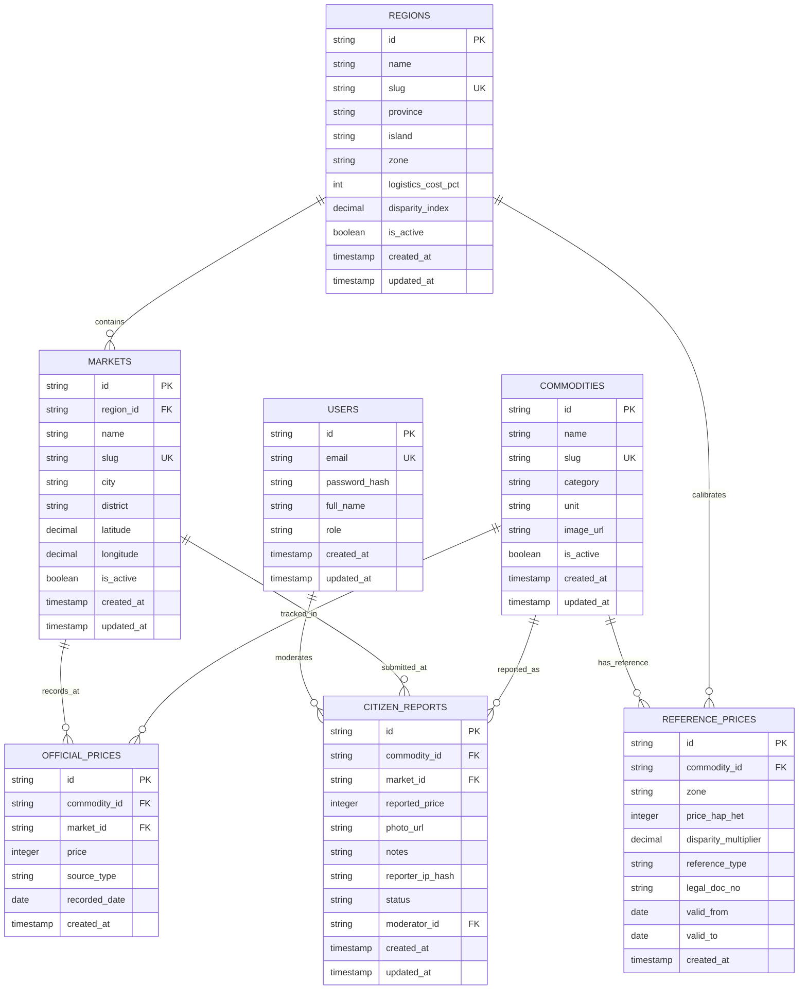

# SCHEMA.md — Database Architecture & Data Dictionary

Dokumen ini adalah **Single Source of Truth (SSOT)** untuk seluruh struktur data, tabel, relasi, indeks, dan tipe data database pada proyek **HargaKu**.

> [!IMPORTANT]
> **Aturan Wajib**: Dilarang membuat migration Prisma (`prisma migrate`, `db push`) sebelum perubahan model disepakati dan dicatat di dokumen ini.

---

## 1. Konvensi & Standar Database

| Aspek | Standar yang Digunakan | Keterangan |
| :--- | :--- | :--- |
| **Engine** | PostgreSQL 16+ | Kompatibel dengan Neon Serverless / Supabase / Local Docker |
| **Penamaan Tabel** | `snake_case`, plural | `commodities`, `markets`, `official_prices`, `citizen_reports` |
| **Penamaan Kolom** | `snake_case` | `commodity_id`, `reported_price`, `recorded_date` |
| **Primary Key** | CUID / UUIDv7 string (`VARCHAR(36)`) | `id String @id @default(cuid())` |
| **Mata Uang & Nominal**| `INTEGER` / `BIGINT` | Disimpan dalam satuan Rupiah bulat (misal: `15000` untuk Rp 15.000) |
| **Timestamps** | Wajib ada di setiap tabel | `created_at TIMESTAMPTZ`, `updated_at TIMESTAMPTZ` |
| **Zona Waktu** | UTC di database, konversi ke `Asia/Jakarta (WIB)` di presentation layer |

---

## 2. Entity Relationship Diagram (ERD)

---

## 3. Data Dictionary & Kamus Kolom

### 3.1. Tabel `regions`
Menyimpan daftar wilayah acuan tingkat **Provinsi** yang dikelompokkan berdasarkan koridor pulau, zonasi Bapanas, dan persentase toleransi biaya logistik penyeberangan kargo laut.
* `id` (VARCHAR/CUID, PK): ID unik wilayah provinsi.
* `name` (VARCHAR(100), NOT NULL): Nama provinsi (misal: "Jawa Barat", "DKI Jakarta", "Jawa Timur", "Kalimantan Timur", "Sulawesi Selatan").
* `slug` (VARCHAR(120), UNIQUE): URL slug wilayah (misal: `jawa-barat`).
* `island` (VARCHAR(50), NOT NULL): Koridor pulau logistik (`JAWA`, `SUMATERA`, `KALIMANTAN`, `SULAWESI`, `BALI_NUSRA`, `MALUKU_PAPUA`).
* `zone` (VARCHAR(20), NOT NULL, DEFAULT 'ZONA_1'): Zonasi pangan Bapanas (`ZONA_1`, `ZONA_2`, `ZONA_3`).
* `logistics_cost_pct` (INTEGER, DEFAULT 0): Estimasi toleransi biaya logistik kargo laut resmi Bapanas (misal: 0% untuk Jawa, 6% Sumatera, 12% Kalimantan, 25% Papua).
* `disparity_index` (DECIMAL(5, 3), DEFAULT 1.000): Koefisien pengali harga acuan dasar nasional (`1 + logistics_cost_pct / 100`).
* `is_active` (BOOLEAN, DEFAULT true): Status keaktifan wilayah.
* `created_at` / `updated_at` (TIMESTAMPTZ).

### 3.2. Tabel `commodities`
Menyimpan daftar bahan pokok strategis yang dipantau (12–15 komoditas).
* `id` (VARCHAR/CUID, PK): ID unik komoditas.
* `name` (VARCHAR(100), NOT NULL): Nama bahan pangan (misal: "Cabai Rawit Merah", "Minyak Goreng MinyaKita").
* `slug` (VARCHAR(120), UNIQUE): URL-friendly slug (misal: `cabai-rawit-merah`).
* `category` (VARCHAR(50), NOT NULL): Kategori pangan (`BERAS`, `CABAI_BAWANG`, `DAGING_UNGGAS`, `MINYAK_GULA`, `SAYURAN`).
* `unit` (VARCHAR(20), NOT NULL): Satuan standar (`kg`, `liter`, `butir`).
* `image_url` (VARCHAR(255), NULL): URL aset foto komoditas.
* `is_active` (BOOLEAN, DEFAULT true): Flag status aktif komoditas.
* `created_at` / `updated_at` (TIMESTAMPTZ).

### 3.3. Tabel `markets`
Menyimpan daftar pasar tradisional yang berada di dalam wilayah cakupan.
* `id` (VARCHAR/CUID, PK): ID unik pasar.
* `region_id` (VARCHAR, FK ➔ `regions.id`, NOT NULL): Relasi ke wilayah kabupaten/kota.
* `name` (VARCHAR(100), NOT NULL): Nama pasar (misal: "Pasar Anyar", "Pasar Kramat Jati").
* `slug` (VARCHAR(120), UNIQUE): URL-friendly slug (`pasar-anyar`).
* `city` (VARCHAR(50), NOT NULL): Nama kota/kabupaten.
* `district` (VARCHAR(100), NULL): Nama kecamatan.
* `latitude` (DECIMAL(10, 7), NOT NULL): Koordinat lintang untuk peta Leaflet.
* `longitude` (DECIMAL(10, 7), NOT NULL): Koordinat bujur untuk peta Leaflet.
* `is_active` (BOOLEAN, DEFAULT true): Status aktif pasar dalam sistem.
* `created_at` / `updated_at` (TIMESTAMPTZ).

### 3.4. Tabel `reference_prices` (Lapis 1 — Standarisasi Nasional HAP / HET Terkalibrasi)
Menyimpan ketetapan harga acuan resmi dari Badan Pangan Nasional berdasarkan zonasi wilayah.
* `id` (VARCHAR/CUID, PK): ID unik acuan harga.
* `commodity_id` (VARCHAR, FK ➔ `commodities.id`): Relasi komoditas.
* `zone` (VARCHAR(20), NOT NULL, DEFAULT 'ZONA_1'): Zonasi wilayah regulasi Bapanas (`ZONA_1`, `ZONA_2`, `ZONA_3`).
* `price_hap_het` (INTEGER, NOT NULL): Nominal batas acuan dalam Rupiah untuk zona tersebut.
* `disparity_multiplier` (DECIMAL(4, 3), DEFAULT 1.000): Pengali penyesuaian disparitas wilayah.
* `reference_type` (VARCHAR(20), NOT NULL): Tipe regulasi (`HAP` atau `HET`).
* `legal_doc_no` (VARCHAR(150), NOT NULL): Nomor dasar hukum peraturan (misal: "Perbadan No 17 Tahun 2023").
* `valid_from` (DATE, NOT NULL): Tanggal mulai berlaku regulasi.
* `valid_to` (DATE, NULL): Tanggal berakhir (NULL bila masih aktif).

### 3.5. Tabel `official_prices` (Lapis 2 — Rata-rata Pasar Harian)
Menyimpan harga survei harian resmi dari PIHPS BI atau Panel Bapanas di pasar daerah.
* `id` (VARCHAR/CUID, PK): ID unik pencatatan harga.
* `commodity_id` (VARCHAR, FK ➔ `commodities.id`): Relasi komoditas.
* `market_id` (VARCHAR, FK ➔ `markets.id`): Relasi pasar tempat survei.
* `price` (INTEGER, NOT NULL): Nominal harga harian dalam Rupiah.
* `source_type` (VARCHAR(30), NOT NULL): Sumber data (`PIHPS_BI`, `PANEL_BAPANAS`, `SIMULASI_DEMO`).
* `recorded_date` (DATE, NOT NULL): Tanggal pencatatan harga (harian).
* `created_at` (TIMESTAMPTZ, DEFAULT NOW()).

### 3.6. Tabel `citizen_reports` (Lapis 3 — Crowdsourcing Warga)
Menyimpan laporan langsung dari warga di lapangan.
* `id` (VARCHAR/CUID, PK): ID unik laporan warga.
* `commodity_id` (VARCHAR, FK ➔ `commodities.id`): Relasi komoditas yang dilaporkan.
* `market_id` (VARCHAR, FK ➔ `markets.id`): Relasi pasar tempat pembelian.
* `reported_price` (INTEGER, NOT NULL): Nominal harga yang dibeli/ditemukan warga.
* `photo_url` (VARCHAR(255), NULL): URL foto bukti nota/papan harga (sudah distrip metadata EXIF).
* `notes` (TEXT, NULL): Catatan kualitas/kondisi barang.
* `reporter_ip_hash` (VARCHAR(64), NOT NULL): SHA-256 hash dari IP pelapor (pencegahan spam/rate limit tanpa menyimpan IP mentah).
* `status` (VARCHAR(20), DEFAULT 'PENDING'): Status moderasi (`PENDING`, `APPROVED`, `REJECTED`).
* `moderator_id` (VARCHAR, NULL, FK ➔ `users.id`): ID admin yang memoderasi.
* `created_at` / `updated_at` (TIMESTAMPTZ).

### 3.7. Tabel `users`
Akun internal tim moderator / admin HargaKu.
* `id` (VARCHAR/CUID, PK).
* `email` (VARCHAR(150), UNIQUE, NOT NULL).
* `password_hash` (VARCHAR(255), NOT NULL).
* `full_name` (VARCHAR(100), NOT NULL).
* `role` (VARCHAR(20), DEFAULT 'MODERATOR'): `SUPERADMIN` atau `MODERATOR`.

---

## 4. Indeks & Strategi Performa Query

Untuk menjamin query cepat tanpa butuh caching layer kompleks:
1. `CREATE INDEX idx_official_prices_lookup ON official_prices(commodity_id, market_id, recorded_date DESC);`
   ➔ Mempercepat query Cek Harga Wajar dan Dashboard tren harian.
2. `CREATE INDEX idx_citizen_reports_valid ON citizen_reports(commodity_id, market_id, status, created_at DESC);`
   ➔ Mempercepat agregasi perhitungan median laporan warga dalam 7 hari terakhir.
3. `CREATE INDEX idx_markets_coords ON markets(latitude, longitude);`
   ➔ Mempercepat rendering marker peta harga.
